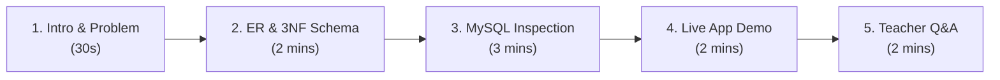

# UniArchive — DBMS Project Review Presentation Walkthrough

A practical, step-by-step presentation script designed for your college DBMS project review. 

---

## Quick Reference Summary

- **Database Name**: `test_uniarchive`
- **Engine**: MySQL 8.0 (InnoDB)
- **Design Level**: Fully normalized in **3NF** (14 relations: 13 base tables + 1 view)
- **Live URL**: `https://uniarchive.vercel.app`
- **Local Port**: Backend on `http://localhost:5001`, Frontend on `http://localhost:3000`

---

## Walkthrough Flow (Total Time: ~7–10 Minutes)



---

## Stage 1: The Introduction (30 Seconds)

**What to say:**
> *"Good morning/afternoon, Professor. For our DBMS project, we developed **UniArchive**, a university resource-sharing platform designed from scratch using relational database principles.*
>
> *The core objective was migrating from an unnormalized document store into a strictly normalized **3NF relational database** in MySQL to guarantee referential integrity, eliminate duplicate storage of course/topic metadata, and support fast multi-table analytical queries."*

---

## Stage 2: ER Design & Normalization (2 Minutes)

Open [docs/case-study.md](file:///c:/Users/DELL/code/uniarchive/docs/case-study.md) or show the schema diagram.

**Key points to explain to your teacher:**
1. **Entities & Cardinalities**:
   - `courses` 1 : N `resources` (one course has many resources)
   - `users` 1 : N `resources` (author relationship)
   - `resources` M : N `topics` (resolved through associative table `resource_topics`)
   - `comments` is a **Weak Entity** dependent on `resources` (enforced via `ON DELETE CASCADE`).
2. **Step-by-Step Normalization**:
   - **1NF (Atomic Attributes)**: Removed repeating arrays (such as topic tags and comments from the original document prototype) into separate tables. Every cell stores single atomic values.
   - **2NF (No Partial Dependencies)**: In composite-key junction tables (`resource_topics`, `course_topic_coverage`, `course_activity`), every non-key attribute depends on the *entire* composite key.
   - **3NF (No Transitive Dependencies)**: Extracted all transitively determined attributes (e.g. `course_code → course_name`, `professor_name`, `slot_code`, `semester`, `resource_types`) into dedicated lookup tables.
3. **Controlled Denormalization Trade-off**:
   - *"We deliberately maintained `upvotes`, `views`, and `downloads` as counter columns on `resources`. Re-aggregating counts from an event log on every card render is computationally expensive. To protect integrity, these columns have `CHECK (upvotes >= 0)` constraints and are modified inside atomic SQL transactions."*

---

## Stage 3: Step-by-Step MySQL App Demonstration (3 Minutes)

Open the **MySQL 8.0 Command Line Client** (Start Menu) — no MariaDB needed,
the whole demo runs on your installed MySQL 8.0.

If you prefer `cmd` / PowerShell directly, the client is **not on PATH**, use:

```bat
"C:\Program Files\MySQL\MySQL Server 8.0\bin\mysql.exe" -u uniarchive -pscse
```

> Tip: run `chcp 65001` first in `cmd` so titles with en-dashes (`–`) display
> correctly instead of `?`.

### Step 3.1: Connect and Select Database
```sql
USE test_uniarchive;
```

### Step 3.2: Show All 14 Relations (3NF Tables + View)
```sql
SHOW FULL TABLES;
```
**What to say:**
> *"Here are our 14 relations: 13 normalized base tables using the InnoDB engine for full ACID transactions, plus 1 analytical view (`v_course_overview`)."*

---

### Step 3.3: Inspect Table Structures & Keys

**Run:**
```sql
DESCRIBE resources;
```
**Highlight:**
- Surrogate primary key: `resource_id INT AUTO_INCREMENT`.
- Foreign keys: `course_id`, `slot_id`, `type_id`, `author_id`, `professor_id`, `semester_id`.
- Domain check constraints: `quality_score` and `completeness`.

**Run:**
```sql
DESCRIBE resource_topics;
```
**Highlight:**
- Composite primary key: `(resource_id, topic_id)` resolving the M:N relationship without partial dependency (2NF).

**Run:**
```sql
DESCRIBE comments;
```
**Highlight:**
- Foreign key `resource_id` with `ON DELETE CASCADE`. If a resource is deleted, its comment thread is purged automatically to avoid orphan rows.

---

### Step 3.4: Demonstrate Constraints in Action

Teachers love seeing constraints actively enforce integrity.

#### Test 1: Check constraint rejects invalid quality score (> 100)
```sql
-- This will fail with a CHECK constraint error:
INSERT INTO resources (title, course_id, slot_id, type_id, author_id, quality_score, pdf_url)
VALUES ('Invalid Resource', 1, 1, 1, 1, 150.00, 'https://example.com/x.pdf');
```
*Expected output: `ERROR 3819 (HY000): Check constraint 'chk_resources_quality' is violated.`*

> Note: `pdf_url` is `NOT NULL` with no default, so it **must** be included —
> otherwise you get `ERROR 1364` (no default value) before the CHECK is even
> evaluated.

#### Test 2: Foreign key rejects non-existent author
```sql
-- This will fail because author_id 9999 does not exist:
INSERT INTO resources (title, course_id, slot_id, type_id, author_id, pdf_url)
VALUES ('Orphan Resource', 1, 1, 1, 9999, 'https://example.com/y.pdf');
```
*Expected output: `ERROR 1452 (23000): Cannot add or update a child row: a foreign key constraint fails (... fk_resources_author ...)`*

---

### Step 3.5: Execute Complex SQL Queries

Run these 5 queries in MySQL to showcase your SQL mastery:

#### Query 1: 5-Table JOIN with Aliasing
Shows complete resource metadata by joining entities across 3NF boundaries:
```sql
SELECT 
    r.resource_id,
    r.title,
    c.course_code,
    s.slot_code,
    rt.type_name,
    u.username AS author
FROM resources r
JOIN courses c ON c.course_id = r.course_id
JOIN slots s ON s.slot_id = r.slot_id
JOIN resource_types rt ON rt.type_id = r.type_id
JOIN users u ON u.user_id = r.author_id
ORDER BY r.resource_id;
```

#### Query 2: M:N Many-to-Many Aggregation (`GROUP_CONCAT`)
Aggregates topic tags for each course resource:
```sql
SELECT 
    r.title,
    c.course_code,
    GROUP_CONCAT(t.topic_name ORDER BY t.topic_name SEPARATOR ', ') AS topics
FROM resources r
JOIN courses c ON c.course_id = r.course_id
JOIN resource_topics rt ON rt.resource_id = r.resource_id
JOIN topics t ON t.topic_id = rt.topic_id
GROUP BY r.resource_id;
```

#### Query 3: Analytical Slot Aggregation
Finds top slots by resource count and computes average quality:
```sql
SELECT 
    s.slot_code, 
    COUNT(*) AS total_resources, 
    ROUND(AVG(r.quality_score), 1) AS avg_quality
FROM resources r 
JOIN slots s ON s.slot_id = r.slot_id
GROUP BY s.slot_code 
ORDER BY total_resources DESC;
```

#### Query 4: Subquery with `EXISTS` (Search Pattern Matching)
Simulates the backend search algorithm matching course code, title, or topic name:
```sql
SELECT DISTINCT r.title, c.course_code
FROM resources r
JOIN courses c ON c.course_id = r.course_id
WHERE r.title LIKE '%SQL%' 
   OR c.course_code LIKE '%SQL%'
   OR EXISTS (
       SELECT 1 FROM resource_topics rt 
       JOIN topics t ON t.topic_id = rt.topic_id
       WHERE rt.resource_id = r.resource_id AND t.topic_name LIKE '%SQL%'
   );
```

#### Query 5: Database View Demonstration
Inspect the pre-aggregated analytical view:
```sql
SELECT * FROM v_course_overview;
```

---

## Stage 4: Live Full-Stack Demonstration (2 Minutes)

1. Launch the system by double-clicking [start-uniarchive.bat](file:///c:/Users/DELL/code/uniarchive/start-uniarchive.bat).
2. Ask your teacher to open **`https://uniarchive.vercel.app`** on her phone or browser.

### The Real-Time Persistence Test:
1. Note the current upvote count of Resource #1 in MySQL:
   ```sql
   SELECT resource_id, title, upvotes FROM resources WHERE resource_id = 1;
   ```
2. Click the **Upvote button (thumbs up)** on `uniarchive.vercel.app`.
3. Re-run the query in MySQL:
   ```sql
   SELECT resource_id, title, upvotes FROM resources WHERE resource_id = 1;
   ```
4. **Show her the number increased by 1!**
   > *"This demonstrates real-time ACID persistence. When the client invokes the `/api/resources/1/upvote` endpoint, Express uses parameter binding and updates the InnoDB table directly."*

5. Open a PDF resource (e.g., *Basic SQL Commands Lab Manual*). Show inline PDF streaming and the download button with clean filenames.
6. Switch to the **Analytics tab**: Show how the course completeness, quality distributions, and activity heatmaps are derived dynamically from MySQL.

---

## Stage 5: Teacher Q&A Preparation (Common Questions)

### Q1: "Why did you use MySQL instead of MongoDB?"
> **Answer**: *"Our prototype started on MongoDB, but study resources have strictly relational data: resources belong to courses, courses have slots, topics are shared across multiple courses, and comments belong to resources. In MongoDB, topic names and course codes were duplicated in every document, causing update anomalies. In MySQL 3NF, each entity is stored once, referential integrity is guaranteed by foreign keys, and cascading deletes prevent orphaned records."*

### Q2: "How do you prevent SQL injection?"
> **Answer**: *"All database queries in `server/src/repositories/` use parameterized prepared statements with `?` placeholders via the `mysql2/promise` library. User input is never concatenated into SQL strings."*

### Q3: "How do you handle multi-table writes during upload?"
> **Answer**: *"Resource uploads insert into `resources` and multiple rows in `resource_topics`. We execute them inside an explicit transaction using `withTransaction()`. If any topic fails to link, the transaction executes `ROLLBACK`, guaranteeing no partial records are saved."*

### Q4: "How are passwords stored?"
> **Answer**: *"Passwords in the `users` table are never stored in plaintext. They are hashed using `scrypt` with a unique cryptographically random salt (`scrypt$<salt>$<hash>`) and compared using `crypto.timingSafeEqual` to prevent timing attacks."*

### Q5: "How are tests verified?"
> **Answer**: *"We have an automated test suite with **42 tests** covering schema integrity, 1NF/2NF minimal keys, referential cascades, check constraints, API endpoints, and password security (`cd server && npm test`)."*

---

## Summary Checklist for Review Day

- [ ] Laptop charged and plugged in.
- [ ] MySQL 8.0 running (`net start MySQL80`).
- [ ] Double-click `start-uniarchive.bat` before the presentation.
- [ ] Verify `https://uniarchive.vercel.app` loads on your phone.
- [ ] Have MySQL Workbench open with queries from **Stage 3** ready in a tab.
